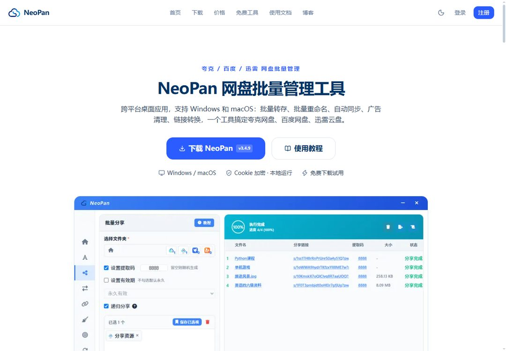

# NeoPan 网盘批量管理工具

## 网盘重度用户的效率外挂

还在一条条点开分享链接转存？还在网盘里手动一个个删广告文件？**NeoPan** 把这些体力活全部自动化：批量转存、批量重命名、自动同步追更、跨网盘搬家——夸克、百度、迅雷、UC 四大网盘，一个桌面应用全搞定。

更狠的是：内置 **Gemini + DeepSeek 双 AI 模型**，自动为你的网盘分享链接生成推广图片和文案，还能一键发布到 WordPress——做网盘拉新推广的人，素材和引流从此不再求人。

🔗 **[免费下载 NeoPan](https://app.neopan.cn/download)** · Windows / macOS 双平台 · 基础功能免费（批量转存 / 重命名 / 分享 / 广告清理 / AI 素材）

## 🚀 它能帮你做什么

- **批量转存，上百条链接一次搞定** —— 智能分批（100→50→25 自动降级）+ 保留原目录结构。别人手动转一下午，你 47 秒跑完 128 条
- **自动同步，追更不再盯盘** —— 给分享链接建个定时任务，资源更新自动增量同步到你网盘，1 小时 / 1 天 / 3 天周期随你设。追剧、追资料的人离不开这个
- **网盘搬家，不用下载再上传** —— 百度网盘转夸克、夸克转迅雷，跨盘互转边下边传、传完即删，不占硬盘不费流量
- **广告清理，一键还你清爽网盘** —— 按关键词和文件大小智能识别广告文件、垃圾文件夹，批量删除
- **链接转换，别人的链接变你的** —— 批量把夸克 / 百度 / 迅雷分享链接转成自己的，支持 Excel 导入导出
- **AI 素材生成 + 全自动发帖** —— 输入分享链接，AI 自动分析资源内容生成推广图和文案；贴吧多吧按序自动发帖、WordPress 一键发布，引流全自动
- **后处理流水线** —— 转存 / 同步 / 链接转换完成后自动执行：重命名 → 清广告 → 插广告，一次配置全程无人值守
- **随机插入文件** —— 分享的文件夹里智能随机插入广告钩子或联系方式，曝光转化两不误

## 📥 安装（三步开跑）

1. 前往 [app.neopan.cn/download](https://app.neopan.cn/download) 下载 Windows 或 macOS 版
2. 安装后添加网盘账号（夸克 Cookie / 百度账号 / 迅雷 App 扫码，强加密本地存储）
3. 选一个批量功能 → 配置规则 → 一键执行，实时看日志

## 💡 进阶玩法

- 转存上百条链接时**开着保留目录结构**，转完目录原样复制，不用重新整理
- 资源型账号用**自动同步 + 增量更新**养号，分享链接永远是最新的
- 做网盘拉新的，把 **AI 素材生成 + 贴吧自动发帖 + WordPress 发布**串起来，从素材到发帖一条龙
- 想多份收入的，加入[**推广返佣计划**](https://app.neopan.cn/blog/neopan-referral-commission-program)：分享专属链接邀人开会员，**最高 50% 佣金**、续购持续返佣、满 10 元提现
- 分享前先跑一遍**广告清理**，再**随机插入**联系方式文件，转化率肉眼可见地涨
- 每个功能的完整参数说明都在[官方文档](https://app.neopan.cn/docs)（30+ 篇图文教程）

## 🔄 版本历史

- **v3.4.7**（最新）—— [更新日志](https://app.neopan.cn/docs/neopan-v3-4-7-changelog)
- **v3.4.6** —— [更新日志](https://app.neopan.cn/docs/neopan-v3-4-6-changelog)
- **v3.4.5** —— [更新日志](https://app.neopan.cn/docs/neopan-v3-4-5-changelog)
- 更早版本见[文档中心](https://app.neopan.cn/docs)

## 🔗 链接

- **官网**：[app.neopan.cn](https://app.neopan.cn/)
- **免费下载**：[app.neopan.cn/download](https://app.neopan.cn/download)
- **使用文档**：[app.neopan.cn/docs](https://app.neopan.cn/docs)（30+ 篇）
- **产品详解仓库**：[neopancn/neopan-release](https://github.com/neopancn/neopan-release)
- **定价**：[app.neopan.cn/pricing](https://app.neopan.cn/pricing)（基础功能免费 · VIP1 ¥25/月 · VIP2 ¥30/月 · 永久 ¥360）
- **免费在线工具**：[网盘链接检测](https://app.neopan.cn/tools/disk-check) + [正则表达式生成器](https://app.neopan.cn/tools/regex-generator)
- **网盘玩法博客**：[app.neopan.cn/blog](https://app.neopan.cn/blog)
